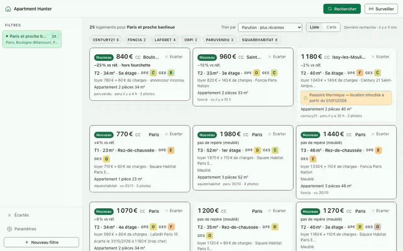
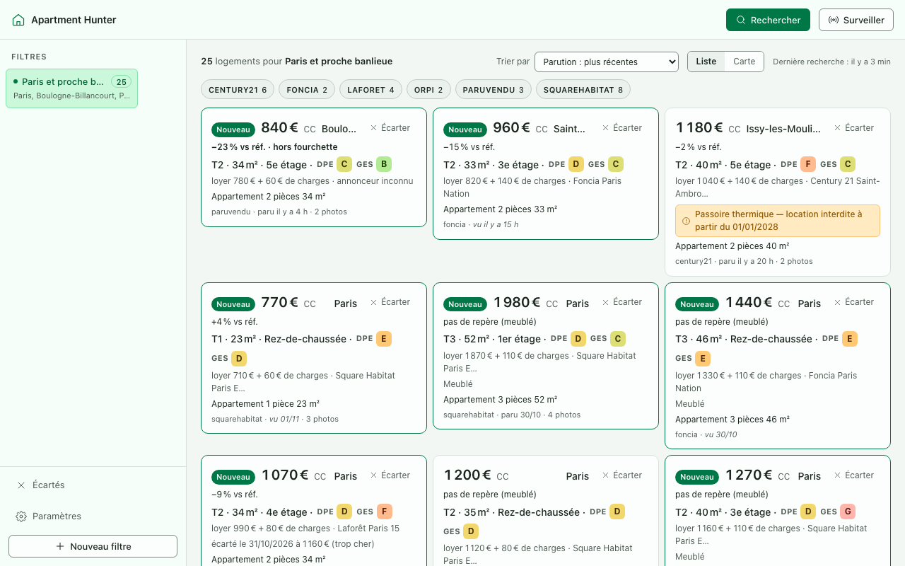
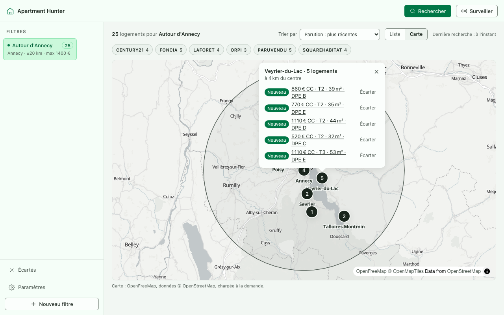
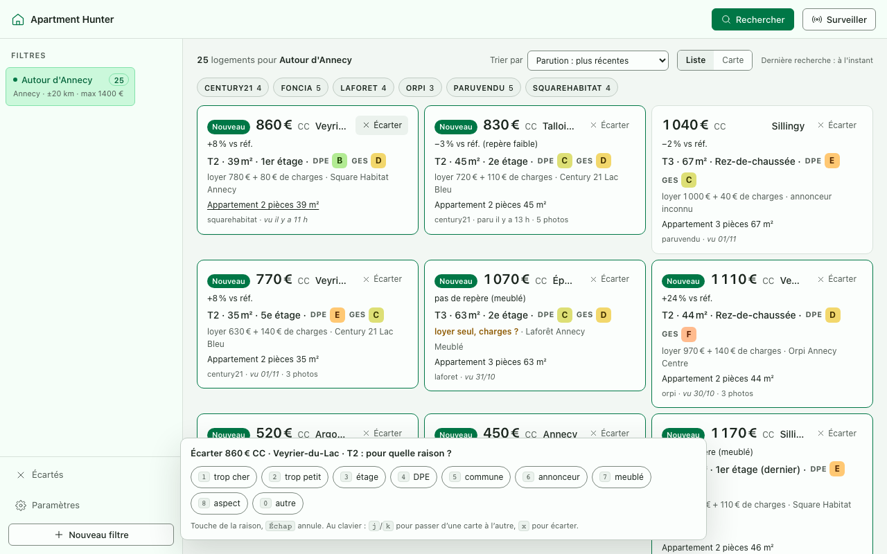
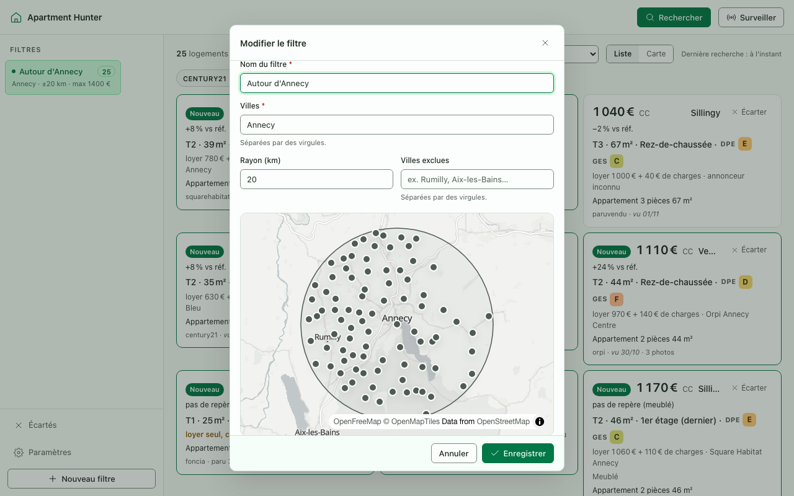
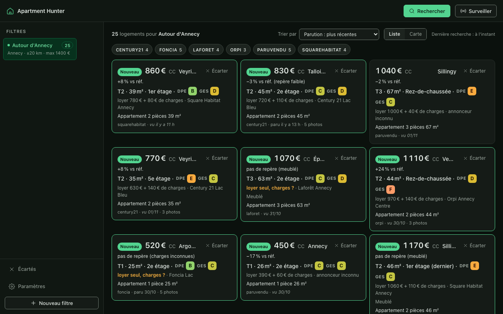
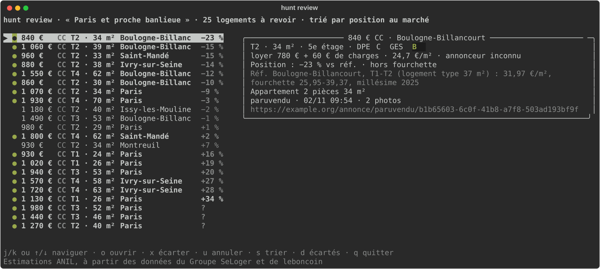

# Apartment Hunter

Un chasseur de locations pour la France, en local : il interroge les sites d'annonces,
garde ce qui passe **vos** critères (budget charges comprises, surface, étage, DPE, rayon
autour de vos villes…), regroupe les doublons d'un même logement entre sites, dit où se
situe chaque loyer face au marché de la commune, et vous laisse **décider** vite : ouvrir,
écarter avec une raison, revenir plus tard. Interface web, revue au clavier dans le
terminal, et veille qui alerte des nouveautés.



<sub>Toutes les captures sont faites sur des **données fictives** (`scripts/seed_demo.py`) :
aucune annonce réelle n'y apparaît.</sub>

---

## Ce que ça fait

| | |
|---|---|
|  | **Une carte par logement**, pas par annonce : un même appartement publié sur trois sites n'apparaît qu'une fois (« aussi sur … »). Le total charges comprises d'abord, la commune, la **position au marché** (« −13 % vs réf. », d'après la Carte des loyers de l'ANIL), la taille, l'étage, le DPE et le GES. « Nouveau » tant que vous ne l'avez pas ouvert. |
|  | **La carte** : toute la zone du filtre, une épingle par commune avec son nombre de logements, la distance au centre, et l'écart possible depuis la carte. |
|  | **Écarter** d'une touche avec une raison (trop cher, étage, DPE, commune…). Le logement disparaît de partout, doublons compris, même s'il est republié ailleurs. Dans `hunt review`, au troisième écart pour la même raison, l'outil propose d'ajuster le filtre. |
|  | **Les filtres** : villes et rayon dessinés sur la carte, communes à exclure d'un toucher, budget, surface, pièces, étage, DPE, meublé, fraîcheur des annonces. |
|  | **Thème** clair, sombre ou celui du système (Paramètres). |

Et au terminal, la même décision sans souris :



---

## Installation

Prérequis : **Python 3.13 ou plus** et [**uv**](https://docs.astral.sh/uv/).

```bash
git clone https://github.com/LucasLaurens/apartment-hunter.git
cd apartment-hunter
uv sync                 # dépendances
cp .env.example .env    # configuration (aucun identifiant n'est nécessaire)
```

Mettez dans `.env` un `GEOCODING_USER_AGENT` qui vous identifie (exigé par Nominatim,
le géocodeur d'OpenStreetMap). Le reste a des valeurs par défaut (voir plus bas).

Pour développer : `uv sync --extra dev`, `make install-hooks`, puis `make full` avant
chaque commit (ruff, format, mypy strict, tests).

### Essayer sans rien crawler

Une base de démonstration, remplie d'annonces fictives à Paris et en proche banlieue :

```bash
uv run python scripts/seed_demo.py demo.db
DATABASE_URL=demo.db uv run hunt serve
```

Puis ouvrez <http://127.0.0.1:8080>. `DATABASE_URL=demo.db uv run hunt review` fonctionne aussi.

---

## Utilisation

### 1. Créer un filtre

Dans l'interface web (`hunt serve`, bouton **Nouveau filtre**) ou au terminal :

```bash
uv run hunt filter add          # assistant interactif
```

Un filtre, c'est une ou plusieurs villes et un rayon (la carte montre la zone), puis vos
critères. Tout critère laissé vide ne filtre rien : une annonce qui ne dit pas son étage
n'est pas écartée pour autant.

### 2. Lancer une recherche

Bouton **Rechercher** dans l'interface, ou :

```bash
uv run hunt search              # une recherche, les 10 meilleurs logements
```

Chaque source est interrogée à son rythme, sous un nom honnête ; les résultats arrivent
au fil de l'eau. Le premier affichage télécharge aussi la Carte des loyers (~14 Mo, une
fois par millésime).

### 3. Décider

- **Web** : `j` / `k` pour passer d'une carte à l'autre, `x` pour écarter puis la touche de
  la raison, **Annuler** juste après pour revenir en arrière ; **Écartés** dans la barre
  latérale pour restaurer. Tri par parution, prix, surface, prix au m² ou position au marché ;
  pastilles pour ne voir qu'une source ; bascule **Liste / Carte**.
- **Terminal** : `uv run hunt review` — `j`/`k` ou flèches, `o` ouvre l'annonce, `x` écarte,
  `u` annule, `s` change le tri, `d` montre les écartés (et `u` les restaure).

### 4. Surveiller

```bash
uv run hunt watch               # recrawle à la cadence du filtre, alerte des nouveautés
```

Ou **Surveiller** dans l'interface. Deux cadences par filtre : la recherche (30 min par
défaut, 5 au minimum) et l'alerte (15 min).

---

## Sources

9 sites scrapés (FNAIM seulement quand les règles des sites sont ignorées), tous **publics** (sans login), sous un nom honnête et sans contournement anti-bot :

| Source | Méthode | DPE / GES |
|--------|---------|-----------|
| **PAP** | httpx + BS4 | DPE liste |
| **Orpi** | curl_cffi + SSR HTML | DPE + GES page détail |
| **Foncia** | curl_cffi + SSR HTML | DPE + GES sur la carte |
| **ParuVendu** | curl_cffi + SSR HTML | DPE + GES page détail |
| **Century21** | curl_cffi + SSR HTML | DPE + GES page détail |
| **Laforêt** | curl_cffi + SSR HTML | — |
| **Citya** | curl_cffi + SSR HTML | DPE + GES page détail |
| **Square Habitat** | curl_cffi + JSON `ng-state` | DPE + GES page détail |
| **FNAIM** (règles des sites ignorées seulement) | curl_cffi + SSR HTML | DPE + GES page détail |

Sources retirées : **SeLoger** (ne passait DataDome qu'en masquant l'automatisation), **Figaro Immo** et **EntreParticuliers** (Cloudflare refuse un client qui ne se fait pas passer pour Chrome), Jinka (login), Locservice (conditions d'utilisation), **LeBonCoin** (captcha DataDome), **Logic-Immo** (SPA sans accès scraping pur). Détails : [Sources](docs/functional/sources.md).

Le réglage **Règles des sites** (Paramètres, ou `hunt rules ignore`) rouvre à vos risques les sources refusées pour leur `robots.txt` ou leurs CGU ; les protections anti-bot restent respectées ([ADR-0012](docs/decisions/0012-le-chasseur-peut-ignorer-les-regles-des-sites.md)).

---

## Commandes CLI

```
hunt search                        # Recherche one-shot → top 10
hunt search --filter "Mon filtre"  # Filtre spécifique
hunt search --limit 20             # Plus de résultats

# Recherche ad-hoc (sans filtre sauvegardé) — mappe le formulaire web 1:1
hunt search \
  --city Paris --radius 8 \
  --exclude "Saint-Denis,Aubervilliers,Ivry-sur-Seine" \
  --max-price 1800 --min-surface 35 \
  --unfurnished --no-ground-floor --no-first-floor \
  --dpe A,B,C,D -n 25

hunt watch                         # Surveillance continue
hunt watch --filter "Mon filtre"   # Un seul filtre
hunt watch --interval 10           # Override intervalle (minutes, minimum 5)

hunt review                        # Revue au terminal, par position au marché : j/k ou ↑/↓, o ouvrir, x écarter, u annuler, s trier, d écartés
hunt review --dismissed            # Logements écartés : u restaure, d revient à la revue
hunt review --filter "Mon filtre"  # Un filtre précis

hunt serve                         # Interface web locale → http://127.0.0.1:8080
                                   # Écarter : bouton sur la carte, ou j/k puis x et la raison ; « Écartés » pour restaurer
                                   # Carte : bascule Liste / Carte, et zone du filtre dans sa modale (OpenFreeMap)
hunt serve --port 3000             # Port personnalisé

hunt filter add                    # Assistant interactif
hunt filter list                   # Lister les filtres sauvegardés
hunt filter delete <id>            # Supprimer un filtre
hunt clean                         # Supprimer les annonces hors filtre et celles non revues depuis 7 jours (confirmation)
hunt clean --unseen-days 2         # … non revues depuis 2 jours (0 = toutes) ; -y sans confirmation
hunt clean --cache                 # Effacer aussi la Carte des loyers téléchargée (retéléchargée au besoin)
hunt rules                         # Règles des sites : respectées ou ignorées (ADR-0012)
hunt rules ignore                  # Ignorer robots.txt et les CGU des sites, à vos risques
hunt rules honour                  # Les respecter de nouveau (défaut)
```

---

## Variables d'environnement

| Variable | Défaut | Description |
|----------|--------|-------------|
| `DATABASE_URL` | `apartment_hunter.db` | Chemin SQLite |
| `LOG_LEVEL` | `INFO` | DEBUG / INFO / WARNING |
| `GEOCODING_USER_AGENT` | `apartment-hunter/0.1.0` | Requis par Nominatim |
| `RENT_MAP_CACHE_DIR` | `.cache/carte-des-loyers` | Fichiers de la Carte des loyers, téléchargés une fois par millésime (~14 Mo) |
| `RATE_LIMIT_SECONDS` | `1.5` | Délai minimum entre requêtes par domaine |
| `MAX_CONCURRENT_CRAWLERS` | `5` | Crawlers parallèles maximum |

> Les notifications sont en terminal + interface web — aucune config email/SMTP requise.

---

## Documentation

### Fonctionnelle
| Document | Description |
|----------|-------------|
| [Vue d'ensemble](docs/functional/overview.md) | Comment ça marche de bout en bout |
| [Glossaire](docs/functional/glossaire.md) | Le vocabulaire du domaine, mot par mot, et les écarts connus |
| [Filtres](docs/functional/filters.md) | Tous les critères de recherche expliqués |
| [Notifications](docs/functional/notifications.md) | Terminal + signal in-app |
| [Sources](docs/functional/sources.md) | Sites scrapés, données disponibles, limites |
| [Recherche de sources, novembre 2026](docs/research/sources-2026-11.md) | 14 sites examinés au 2026-11-01 |

### Technique
| Document | Description |
|----------|-------------|
| [Architecture](docs/technical/architecture.md) | Clean Architecture, couches, règle de dépendance |
| [Crawlers](docs/technical/crawlers.md) | Fonctionnement interne, anti-bot, ajouter une source |
| [Modèle de données](docs/technical/data-model.md) | Entités, value objects, schéma SQLite |
| [Scheduler](docs/technical/scheduler.md) | Mode watch, boucle de polling, concurrence |
| [Sécurité](docs/technical/security.md) | Credentials, rate limiting, robots.txt |
| [Conventions de code](docs/technical/conventions.md) | Règles suivies par le code et la doc |
| [Décisions (ADR)](docs/decisions/README.md) | Les arbitrages métier actés, et ce qu'ils interdisent |
| [Design de l'interface](DESIGN.md) | Thème Clair / Sombre / Système, tokens OKLCH, composants, accessibilité |
| [Produit](PRODUCT.md) | Utilisateur, objectif, principes qui justifient le design |

---

## Stack technique

- **Python 3.13** — async/await natif ; le minimum, car `urllib.robotparser` ne lit les jokers `*` et `$` de robots.txt qu'à partir de 3.13
- **httpx** — HTTP async avec retry
- **curl_cffi** — client HTTP des crawlers HTML, sans imitation de navigateur (Orpi, Foncia, ParuVendu, Century21, Laforêt, Citya, Square Habitat, FNAIM)
- **Playwright** — Chromium headless pour l'audit de l'interface (`make ui-check`)
- **FastAPI + uvicorn** — interface web locale
- **BeautifulSoup4 + lxml** — parsing HTML
- **aiosqlite** — SQLite async
- **Pydantic-settings** — configuration typée
- **geopy + Nominatim + geo.api.gouv.fr** — géocodage et expansion des communes par rayon
- **Typer + Rich** — CLI et affichage
- **tenacity** — retry avec backoff exponentiel

---

## Régénérer les captures

```bash
uv run python scripts/seed_demo.py demo.db
DATABASE_URL=demo.db uv run hunt serve --port 8001          # dans un autre terminal
DATABASE_URL=demo.db uv run python scripts/capture_readme_media.py http://127.0.0.1:8001
```

Écrit `docs/media/` : captures (Playwright), visite animée (ffmpeg) et `hunt review` (Rich, SVG).

---

## Évolutions envisagées

Rien de tout ceci n'est promis ; ce sont les pistes ouvertes, de la plus mûre à la plus
lointaine.

### Plus de sources
- **PAP**, dès que sa protection Cloudflare laisse passer un client honnête : le crawler
  est prêt, limité à ce que son `robots.txt` autorise (la page de la commune).
- **Les agences locales indépendantes**, sur leurs propres sites, quand leurs conditions
  d'utilisation le permettent.
- **Les réseaux à faible volume** écartés pour l'instant (ERA, Capifrance, iad, Nestenn),
  si leur stock autour de la ville cherchée le justifie.
- **Des accords** avec les portails qui refusent la collecte : c'est la seule voie propre
  vers leurs annonces.

### Plus de fonctionnalités
- **Un score au-delà du prix** : la position au marché pèse déjà, l'étage, le DPE ou la
  distance au travail pourraient compter aussi.
- **L'historique d'un logement** : baisses de loyer, republications, durée en ligne.
- **Des alertes ailleurs que dans le terminal** (notification du système, e-mail), en option.
- **La Carte des loyers préchargée** au démarrage de `hunt serve`, plutôt qu'à la première
  recherche.

### Interface et expérience
- **Le mobile** : la première carte arrive trop bas sur un téléphone.
- **La place de la page web face à `hunt review`** : deux surfaces de décision, à
  rapprocher.
- **Une politique de sécurité de contenu (CSP)** stricte, qui demande de retirer les
  gestionnaires `onclick` en ligne.

### Sous le capot
- Un seul client HTTP (`httpx`) au lieu de deux, une horloge injectée partout, un plafond
  sur la taille des réponses, une CI durcie (actions épinglées, `uv sync --locked`).

---

## Licence

[MIT](LICENSE). Les skills de `.claude/skills/` reprises de
[mattpocock/skills](https://github.com/mattpocock/skills) restent sous sa licence MIT
([notice](.claude/skills/THIRD_PARTY_LICENSE)). Le code est libre ; les annonces collectées restent la propriété de leurs
éditeurs, et chaque utilisateur répond de l'usage qu'il fait de l'outil.
